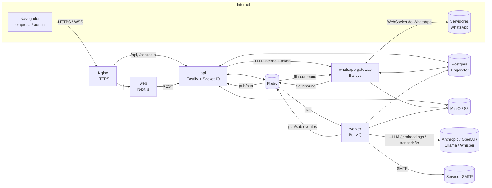

# Plataforma SaaS de Agentes de IA para WhatsApp: Plano Técnico (Etapa 0)

Documento de planejamento. Nenhum código foi escrito ainda. Tudo aqui está sujeito à sua aprovação.

Nome provisório do projeto e dos pacotes: `plataforma` (escopo `@plataforma/*`). Trocamos quando você definir a marca.

---

## 1. Arquitetura geral

São 4 serviços de aplicação, 3 de infraestrutura e o Nginx na frente.

| Serviço | Tecnologia | Responsabilidade |
|---|---|---|
| `web` | Next.js (App Router) | Painel da empresa, painel admin, páginas públicas (login, cadastro, termos). Não acessa o banco diretamente: fala só com a `api` |
| `api` | Fastify + Zod + Prisma | Autenticação, regras de negócio, CRUD de tudo, Socket.IO para o painel, upload de arquivos, endpoints internos para os outros serviços |
| `worker` | BullMQ + Prisma | Processa mensagens (pipeline do agente), embeddings, importação CSV, transcrição, resumos de contato, relatórios, emails, LGPD, contadores de uso |
| `whatsapp-gateway` | Baileys + BullMQ | Mantém uma sessão por número, gera QR, recebe e envia mensagens, publica eventos na fila. Nunca chama a IA |
| `postgres` | PostgreSQL 16 + pgvector | Banco único, multiempresa por coluna `companyId` |
| `redis` | Redis 7 | Filas BullMQ, rate limit, cache, adapter do Socket.IO, travas distribuídas, buffer de agrupamento de mensagens |
| `minio` | MinIO (S3) | Mídias recebidas, arquivos da base de conhecimento, logos, exportações LGPD |
| `nginx` | Nginx + Certbot | HTTPS, proxy para `web` e `api` (incluindo WebSocket), headers de segurança |

### Princípios

1. **Gateway burro, worker inteligente.** O gateway só traduz eventos do WhatsApp em jobs e jobs de envio em mensagens do WhatsApp.
2. **Filas como contrato entre serviços.** Os tipos dos jobs ficam em `packages/queue`, validados com Zod nos dois lados.
3. **Comunicação síncrona interna** (ex.: a `api` pedindo ao gateway para gerar um QR ou desconectar) usa HTTP interno com header `x-internal-token` e nunca é exposta pelo Nginx.
4. **Eventos em tempo real**: worker e gateway publicam no Redis (pub/sub); a `api` repassa via Socket.IO para as salas `company:{id}` e `conversation:{id}`. Assim só a `api` fala com o navegador.
5. **Isolamento de empresa no backend**: extensão do Prisma que exige `companyId` em toda consulta de modelos de tenant (detalhe na seção 3.1), mais testes automatizados.
6. **Logs JSON com Pino**, campos fixos: `service`, `companyId`, `conversationId`, `jobId`, `requestId`.

### Por que o loop do agente é nosso (e não um agente hospedado)

A camada de IA precisa ser plugável (Anthropic, OpenAI, Ollama). Por isso o laço de tool calling roda no `worker`, sobre uma interface comum de provedor. Para a Anthropic usaremos o SDK oficial `@anthropic-ai/sdk` com a Messages API. Modelo padrão sugerido: `claude-opus-5-5` (configurável pelo admin; você pode escolher um modelo mais barato como `claude-haiku-5-5` ou `claude-sonnet-5-5` para reduzir custo por mensagem, mas a decisão é sua).

---

## 2. Diagrama dos serviços



### Fluxo de uma mensagem recebida

```
WhatsApp -> gateway (messages.upsert)
  1. Ignora: grupos (se configurado), status, mensagens próprias, contatos bloqueados (cache Redis)
  2. Baixa mídia para o S3, salva Message (dedupe por waMessageId)
  3. Publica job `inbound.message` { companyId, sessionId, messageId }
worker (fila inbound, concorrência por conversa via chave de grupo)
  4. Carrega empresa, plano, agente, conversa, contato
  5. Checagens: agente ativo? empresa ativa e dentro do limite? conversa com humano
     (humanPausedUntil)? contato bloqueado? dentro do horário? -> senão, mensagem
     fora do horário (uma vez por janela) ou nada
  6. Áudio -> transcrição; imagem -> descrição (se o modelo suportar)
  7. Agrupamento: grava no buffer Redis e agenda job `agent.respond` com atraso
     = janela configurada; mensagens novas reagendam (debounce)
  8. agent.respond: monta contexto (prompt do sistema a partir da config versionada,
     resumo e fatos do contato, últimas 20 mensagens, trechos do pgvector),
     chama o LLM com ferramentas, executa ferramentas, repete até resposta final
  9. Verificação da resposta (guardrail): preços, links, Pix, telefones, endereços
     e horários presentes no texto precisam ter vindo de resultados de ferramenta.
     Falhou -> regenera 1 vez com aviso; falhou de novo -> transfere para humano
 10. Divide em partes, aplica proibições, salva AgentRun (modelo, tokens, custo,
     latência, trechos usados), incrementa UsageCounter
 11. Publica jobs `outbound.send` com atraso variável e "digitando..."
gateway (fila outbound, rate limit por número)
 12. Envia, atualiza status da Message, publica evento em tempo real
```

---

## 3. Modelagem do banco

Convenções: IDs `cuid2` em texto; `createdAt`/`updatedAt` em todas as tabelas; `deletedAt` (exclusão lógica) onde indicado; valores em dinheiro em centavos (`Int`); campos `*Enc` são `Bytes` cifrados com AES-256-GCM (chave mestra em variável de ambiente, com versão da chave para rotação).

### 3.1 Estratégia de isolamento

- Todo modelo de tenant tem `companyId` e índice que começa por `companyId`.
- `packages/db` exporta `tenantDb(companyId)`: uma extensão do Prisma Client que injeta `where.companyId` em `findMany/findFirst/update/delete/count/aggregate` e `data.companyId` em `create`, e lança erro se a consulta tentar outro `companyId`. `findUnique` por id é reescrito para `findFirst` com `companyId`.
- O client "cru" só é usado em módulos explicitamente marcados (auth, admin, gateway) e o lint proíbe importá-lo fora deles.
- Consultas SQL cruas (pgvector) passam por uma função que exige `companyId` como parâmetro.
- Testes de integração criam duas empresas e tentam acessar cada recurso da outra por id: todos devem retornar 404.
- Sem Row Level Security no Postgres (decisão confirmada).

### 3.2 Identidade e acesso

**User**
| Campo | Tipo | Observação |
|---|---|---|
| id | String PK | |
| email | String | único, minúsculo |
| passwordHash | String | Argon2id |
| name | String | |
| emailVerifiedAt | DateTime? | |
| totpSecretEnc | Bytes? | 2FA |
| totpEnabledAt | DateTime? | |
| recoveryCodesHash | String[] | códigos de recuperação 2FA |
| theme | Enum DARK/LIGHT/SYSTEM | padrão DARK |
| failedLoginCount | Int | |
| lockedUntil | DateTime? | bloqueio por força bruta |
| lastLoginAt | DateTime? | |
| deletedAt | DateTime? | |
Índices: `email` único.

**AdminUser** (tabela separada, login separado)
id, email (único), passwordHash, name, totpSecretEnc (obrigatório após primeiro login), totpEnabledAt, recoveryCodesHash, failedLoginCount, lockedUntil, lastLoginAt, isActive.

**AuthSession** (refresh tokens com rotação e detecção de reuso)
| Campo | Tipo | Observação |
|---|---|---|
| id | String PK | |
| subjectType | Enum USER/ADMIN | |
| userId | String? FK User | |
| adminId | String? FK AdminUser | |
| familyId | String | família de rotação; reuso revoga a família toda |
| tokenHash | String | SHA-256 do refresh token |
| userAgent, ip | String? | |
| expiresAt | DateTime | |
| revokedAt | DateTime? | |
| replacedById | String? | |
Índices: `tokenHash` único, `(userId)`, `(adminId)`, `(familyId)`.

**EmailToken**: id, userId FK, type (VERIFY_EMAIL / RESET_PASSWORD / CHANGE_EMAIL), tokenHash (único), expiresAt, usedAt. Índice `(userId, type)`.

**LoginAttempt**: id, email, ip, subjectType, success, reason, createdAt. Índices `(email, createdAt)`, `(ip, createdAt)`. O bloqueio em tempo real fica no Redis; esta tabela serve para auditoria.

**LegalAcceptance**: id, userId FK, document (TERMS / PRIVACY), version, ip, acceptedAt. Índice `(userId, document)`.

### 3.3 Empresa, equipe e planos

**Company**
| Campo | Tipo | Observação |
|---|---|---|
| id | String PK | |
| name | String | nome fantasia |
| legalName, document | String? | razão social, CNPJ/CPF |
| slug | String | único |
| segment | Enum RESTAURANT/CLINIC/BEAUTY/STORE/SERVICES/OTHER | |
| timezone | String | padrão `America/Sao_Paulo` |
| logoKey | String? | chave no S3 |
| status | Enum TRIAL/ACTIVE/SUSPENDED/BLOCKED/DELETION_SCHEDULED | |
| onboardingStep | Int | |
| onboardingCompletedAt | DateTime? | |
| deletedAt | DateTime? | |
Índices: `slug` único, `(status)`, `(createdAt)`.

**Membership**: id, companyId FK, userId FK, role (OWNER/MANAGER/ATTENDANT), isActive, createdAt. Único `(companyId, userId)`; índice `(userId)`.

**Invitation**: id, companyId FK, email, role, tokenHash (único), invitedById FK Membership, expiresAt, acceptedAt, revokedAt. Índice `(companyId, email)`.

**Plan**
| Campo | Tipo |
|---|---|
| id, name, slug (único) | String |
| description | String? |
| priceCents | Int |
| currency | String (BRL) |
| interval | Enum MONTHLY/YEARLY |
| maxMessagesPerMonth | Int |
| maxAgents | Int |
| maxMembers | Int |
| maxKnowledgeMb | Int |
| trialDays | Int |
| features | Json (flags extras) |
| isPublic, isActive | Boolean |
| sortOrder | Int |

**Subscription**: id, companyId FK (único), planId FK, status (TRIALING/ACTIVE/PAST_DUE/CANCELED/EXPIRED), trialEndsAt, currentPeriodStart, currentPeriodEnd, cancelAt, billingProvider (NONE/MERCADO_PAGO/ASAAS), providerCustomerId, providerSubscriptionId. Índices `(status)`, `(trialEndsAt)`.

**Invoice**: id, companyId FK, subscriptionId FK, amountCents, status (DRAFT/OPEN/PAID/VOID/OVERDUE), dueDate, paidAt, billingProvider, providerInvoiceId, paymentUrl, pdfKey. Índice `(companyId, dueDate desc)`.

**BillingWebhookEvent** (preparado para a integração futura): id, provider, externalId (único por provider), payload Json, processedAt, error.

**UsageCounter**: id, companyId FK, period (`YYYY-MM`), messagesIn, messagesOut, aiRequests, inputTokens, outputTokens, costMicros (BigInt), knowledgeBytes (BigInt), warned80At, limitReachedAt. Único `(companyId, period)`. Incremento atômico; o Redis guarda o valor quente para checagem rápida.

### 3.4 Agente

**Agent**
| Campo | Tipo | Observação |
|---|---|---|
| id | String PK | |
| companyId | FK | |
| name | String | |
| isEnabled | Boolean | botão ligar/pausar |
| pauseReason | Enum MANUAL/PLAN_LIMIT/COMPANY_BLOCKED? | |
| currentVersionId | FK AgentConfigVersion? | |
| deletedAt | DateTime? | |
Índice `(companyId)`.

**AgentConfigVersion** (histórico e restauração)
| Campo | Tipo | Observação |
|---|---|---|
| id | String PK | |
| companyId, agentId | FK | |
| version | Int | sequencial por agente |
| schemaVersion | Int | versão do formato do JSON |
| config | Json | validado por Zod (abaixo) |
| note | String? | "Restaurado da v3", etc. |
| createdById | FK Membership? | |
Único `(agentId, version)`.

Conteúdo de `config` (schema Zod em `packages/shared`):
- `persona`: nome do agente, apresentação
- `style`: FORMAL / FRIENDLY / CASUAL / CUSTOM + texto livre
- `emojis`: NONE / FEW / MANY
- `length`: SHORT / MEDIUM / DETAILED
- `useContactName`: boolean
- `messages`: boas-vindas, fora do horário, transferência
- `prohibitions`: noDiscount, noOrderConfirmation, noDeadlinePromise, noCompetitors, noOffTopic + `customRules[]`
- `humanize`: typingSimulation, minDelayMs, maxDelayMs, msPerChar
- `batching`: windowSeconds
- `handoff`: keywords[], triggers (HUMAN_REQUEST, COMPLAINT, CANCELLATION, UNKNOWN_ANSWER), notifyMembershipIds[], notifyPhone, humanPauseMinutes
- `limits`: maxCharsPerMessage, maxMessagesPerReply
- `model` (opcional): sobrescrever provedor/modelo, se o plano permitir

Escolha: guardar a config como JSON versionado em vez de colunas normalizadas. Vantagem: histórico e restauração triviais, uma versão é um retrato completo e imutável. Custo: consultas por campo individual são raras, então não pesa.

### 3.5 Informações do negócio (por empresa, compartilhadas entre agentes)

**BusinessProfile**: companyId (PK e FK), street, number, complement, district, city, state, zip, mapsUrl, phone, email, instagram, website, pixKey, pixKeyType (CPF/CNPJ/EMAIL/PHONE/RANDOM), pixHolderName, paymentMethods (String[]), menuUrl, deliveryFeeCents, deliveryArea (texto), avgDeliveryMinutes, extra Json.

**BusinessHour**: id, companyId, weekday (0 a 6), opensAt (`HH:mm`), closesAt. Várias linhas por dia representam intervalos. Índice `(companyId, weekday)`.

**SpecialDate**: id, companyId, date (Date), label, isClosed, opensAt?, closesAt?. Único `(companyId, date)`.

**CustomField**: id, companyId, label, value, usageHint ("quando usar"), isActive, sortOrder. Índice `(companyId)`.

### 3.6 Base de conhecimento

**FaqItem**: id, companyId, question, answer, tags String[], isActive, deletedAt. Índice `(companyId)`.

**ProductCategory**: id, companyId, name, sortOrder. Único `(companyId, name)`.

**Product**: id, companyId, categoryId FK?, name, description, priceCents, imageKey, sku, isAvailable, attributes Json, deletedAt. Índices `(companyId, isAvailable)`, `(companyId, name)` com trigram para busca.

**KnowledgeDocument**: id, companyId, title, kind (PDF/TEXT), fileKey, mimeType, sizeBytes, status (PENDING/PROCESSING/READY/FAILED), error, chunkCount, uploadedById. Índice `(companyId, status)`.

**KnowledgeChunk** (indexado no pgvector)
| Campo | Tipo | Observação |
|---|---|---|
| id | String PK | |
| companyId | FK | |
| sourceType | Enum DOCUMENT/FAQ/PRODUCT/CUSTOM_FIELD/MEDIA | |
| documentId, faqId, productId, mediaAssetId | FK? | só um preenchido |
| content | Text | |
| tokenCount | Int | |
| embedding | `vector(N)` | `Unsupported` no Prisma, SQL cru |
| embeddingModel | String | para saber quando reindexar |
| metadata | Json | página, título |
Índices: `(companyId, sourceType)`, HNSW em `embedding` com `vector_cosine_ops`. Toda busca filtra por `companyId` antes da similaridade.

**MediaAsset**: id, companyId, title, description (o agente usa para decidir quando enviar), kind (IMAGE/PDF/VIDEO/AUDIO), fileKey, mimeType, sizeBytes, isActive. Índice `(companyId, isActive)`.

**ImportJob**: id, companyId, type (PRODUCTS_CSV), fileKey, status, totalRows, okRows, errorRows, errors Json, createdById.

### 3.7 WhatsApp

**WhatsappSession**
| Campo | Tipo | Observação |
|---|---|---|
| id | String PK | |
| companyId | FK | |
| agentId | FK Agent | único: 1 agente = 1 número |
| status | Enum DISCONNECTED/CONNECTING/QR_PENDING/CONNECTED/LOGGED_OUT/ERROR | |
| phoneNumber, pushName | String? | |
| lastConnectedAt, lastDisconnectedAt | DateTime? | |
| disconnectReason | String? | |
| ignoreGroups | Boolean | padrão true |
| desiredState | Enum ON/OFF | o gateway reconecta tudo com ON ao iniciar |
Índices `(companyId)`, `(status)`.

**WhatsappAuthKey** (estado de autenticação do Baileys, cifrado)
id, sessionId FK, keyType (`creds`, `pre-key`, `session`, `sender-key`, `app-state-sync-key`...), keyId, valueEnc Bytes. Único `(sessionId, keyType, keyId)`. Cache em memória no gateway para não bater no banco a cada mensagem.

**BlockedContact**: id, companyId, phoneE164, reason, createdById. Único `(companyId, phoneE164)`.

### 3.8 Contatos e conversas

**Contact**: id, companyId, waJid, phoneE164, name (editável), pushName, summary (Text), summaryUpdatedAt, lastSummarizedMessageId, optOut, deletedAt. Único `(companyId, waJid)`; índices `(companyId, phoneE164)`, `(companyId, name)` trigram.

**ContactFact** (fatos lembrados): id, companyId, contactId FK, key, value, source (AI/MANUAL), confidence, updatedAt. Índice `(contactId)`.

**Tag**: id, companyId, name, color. Único `(companyId, name)`.
**ConversationTag**: conversationId, tagId. PK composta.

**Conversation**
| Campo | Tipo | Observação |
|---|---|---|
| id | String PK | |
| companyId, agentId, contactId | FK | |
| sessionId | FK WhatsappSession? | nulo no simulador |
| channel | Enum WHATSAPP/SANDBOX | simulador não entra em métricas |
| status | Enum AGENT/HUMAN/WAITING_HUMAN/CLOSED | filtros da tela |
| assignedMembershipId | FK? | |
| humanPausedUntil | DateTime? | |
| handoffReason | String? | |
| lastMessageAt, lastInboundAt | DateTime | |
| unreadCount | Int | |
| outOfHoursNotifiedAt | DateTime? | evita repetir aviso |
| closedAt | DateTime? | |
Índices `(companyId, status, lastMessageAt desc)`, `(companyId, contactId, channel)`.

**Message**
| Campo | Tipo | Observação |
|---|---|---|
| id | String PK | |
| companyId, conversationId | FK | |
| direction | Enum IN/OUT | |
| senderType | Enum CONTACT/AGENT/HUMAN_PANEL/HUMAN_PHONE/SYSTEM | HUMAN_PHONE = respondeu pelo celular |
| senderMembershipId | FK? | |
| waMessageId | String? | |
| type | Enum TEXT/AUDIO/IMAGE/VIDEO/DOCUMENT/STICKER/LOCATION/CONTACT/OTHER | |
| text | Text? | |
| mediaKey, mediaMime | String? | |
| mediaSizeBytes | Int? | |
| transcription, mediaDescription | Text? | |
| status | Enum PENDING/SENT/DELIVERED/READ/FAILED | |
| error | String? | |
| agentRunId | FK? | |
| sentAt | DateTime? | |
Índices: único `(companyId, waMessageId)` (dedupe), `(conversationId, createdAt)`, `(companyId, createdAt)`.

**InternalNote**: id, companyId, conversationId, authorMembershipId, body, createdAt. Índice `(conversationId)`.

**HandoffEvent**: id, companyId, conversationId, trigger (KEYWORD/HUMAN_REQUEST/COMPLAINT/CANCELLATION/UNKNOWN_ANSWER/GUARDRAIL/MANUAL/HUMAN_REPLIED), detail, from (AGENT/HUMAN), to, byMembershipId, createdAt. Índice `(companyId, createdAt)`.

**AgentRun** (registro de cada resposta)
| Campo | Tipo |
|---|---|
| id | String PK |
| companyId, conversationId, agentId, configVersionId | FK |
| inboundMessageIds | String[] |
| provider, model | String |
| inputTokens, outputTokens, cacheReadTokens | Int |
| costMicros | BigInt |
| latencyMs | Int |
| toolCalls | Json (nome, entrada, saída resumida) |
| guardResult | Enum PASSED/REGENERATED/BLOCKED_HANDOFF |
| attempts | Int |
| topic | String? (assunto classificado) |
| error | String? |
| isSandbox | Boolean |
Índices `(companyId, createdAt)`, `(conversationId)`.

**AgentRunSource** (o que foi usado): id, companyId, agentRunId, chunkId?, productId?, faqId?, mediaAssetId?, customFieldId?, score Float. Índices `(agentRunId)`, `(companyId, createdAt)` para "itens usados recentemente".

**ResponseFeedback**: id, companyId, messageId FK, agentRunId FK, rating (GOOD/BAD), comment, membershipId, createdAt. Único `(messageId, membershipId)`.

**FrequentQuestion** (gerado por job diário): id, companyId, periodStart, periodEnd, label, count, exampleMessageIds String[]. Índice `(companyId, periodStart)`.

### 3.9 Testes do agente

**AgentTestCase**: id, companyId, agentId, name, input (pode ter várias mensagens: Json), expected, evaluation (CONTAINS/NOT_CONTAINS/LLM_JUDGE), createdById.

**AgentTestRun**: id, companyId, agentId, configVersionId, status (RUNNING/DONE/FAILED), passed, failed, startedById, finishedAt.

**AgentTestResult**: id, testRunId, testCaseId, output, passed, score, reasoning, agentRunId.

### 3.10 Notificações, auditoria, administração e LGPD

**Notification**: id, companyId, userId (destinatário), type (WHATSAPP_DISCONNECTED/HANDOFF/PLAN_80/PLAN_100/NEW_MEMBER/AGENT_ERROR/ANNOUNCEMENT), title, body, data Json, readAt, emailedAt, createdAt. Índice `(userId, readAt, createdAt desc)`.

**AuditLog**
| Campo | Tipo |
|---|---|
| id | String PK |
| companyId | String? (nulo = ação global) |
| actorType | Enum USER/ADMIN/SYSTEM |
| actorUserId, actorAdminId | String? |
| supportSessionId | String? (ação feita em modo suporte) |
| action | String (`agent.config.update`, `member.invite`...) |
| entityType, entityId | String |
| before, after | Json? (com campos sensíveis mascarados) |
| ip, userAgent | String? |
Índices `(companyId, createdAt desc)`, `(actorAdminId, createdAt)`, `(entityType, entityId)`. Somente inserção.

**SupportSession**: id, adminId, companyId, reason, ip, startedAt, endedAt, expiresAt.

**Announcement**: id, title, body (markdown), level (INFO/WARNING/CRITICAL), audience (ALL/PLANS), planIds String[], startsAt, endsAt, createdById. **AnnouncementDismissal**: announcementId + userId (PK composta).

**SegmentTemplate**: id, segment, name, description, agentConfig Json, businessDefaults Json, faqs Json, customFields Json, isActive, sortOrder.

**AiProviderConfig**: id, provider (ANTHROPIC/OPENAI/OLLAMA/WHISPER_LOCAL/OPENAI_WHISPER), purpose (CHAT/EMBEDDING/TRANSCRIPTION/VISION), baseUrl, apiKeyEnc, defaultModel, isDefault, isActive, pricing Json (custo por 1M tokens ou por minuto). Índice `(purpose, isDefault)`.

**SystemSetting**: key (PK), value Json. (SMTP, limites globais, versão atual dos termos.)

**DataRequest** (LGPD): id, companyId, type (EXPORT_COMPANY/DELETE_COMPANY/EXPORT_CONTACT/DELETE_CONTACT), contactId?, requestedById, status (PENDING/PROCESSING/DONE/FAILED/CANCELED), scheduledFor (exclusão com carência de 7 dias), fileKey, completedAt, error.

**SystemError**: id, service, companyId?, conversationId?, code, message, stack, context Json, createdAt. Índice `(createdAt desc)`, `(companyId, createdAt)`. Retenção de 30 dias via job.

### 3.11 Relações principais (resumo)

```
User 1-N Membership N-1 Company
Company 1-1 Subscription N-1 Plan
Company 1-N Agent 1-N AgentConfigVersion
Agent 1-1 WhatsappSession 1-N WhatsappAuthKey
Company 1-1 BusinessProfile, 1-N BusinessHour/SpecialDate/CustomField
Company 1-N FaqItem/Product/KnowledgeDocument/MediaAsset -> 1-N KnowledgeChunk
Company 1-N Contact 1-N Conversation 1-N Message
Conversation 1-N AgentRun 1-N AgentRunSource
Company 1-N UsageCounter (um por mês)
```

---

## 4. Estrutura de pastas

```
plataforma/
├─ apps/
│  ├─ api/
│  │  ├─ src/
│  │  │  ├─ modules/            # um diretório por domínio
│  │  │  │  ├─ auth/            # rotas, serviço, schemas Zod
│  │  │  │  ├─ companies/
│  │  │  │  ├─ members/
│  │  │  │  ├─ agents/
│  │  │  │  ├─ business/
│  │  │  │  ├─ knowledge/
│  │  │  │  ├─ whatsapp/
│  │  │  │  ├─ conversations/
│  │  │  │  ├─ sandbox/
│  │  │  │  ├─ reports/
│  │  │  │  ├─ notifications/
│  │  │  │  ├─ billing/
│  │  │  │  ├─ lgpd/
│  │  │  │  └─ admin/
│  │  │  ├─ plugins/            # auth, tenant, rate-limit, erros, swagger, socket
│  │  │  ├─ realtime/           # Socket.IO + ponte Redis
│  │  │  ├─ internal/           # rotas internas (token)
│  │  │  ├─ app.ts
│  │  │  └─ server.ts
│  │  └─ test/                  # integração (inclui isolamento)
│  ├─ worker/
│  │  └─ src/
│  │     ├─ processors/         # inbound, agent-respond, embeddings, import, email...
│  │     ├─ agent/              # pipeline: contexto, ferramentas, guardrail, divisor
│  │     ├─ schedulers/         # jobs recorrentes
│  │     └─ main.ts
│  ├─ whatsapp-gateway/
│  │  └─ src/
│  │     ├─ session-manager.ts  # mapa de sessões, reconexão
│  │     ├─ auth-state.ts       # estado Baileys no Postgres cifrado
│  │     ├─ inbound.ts
│  │     ├─ outbound.ts         # consumidor da fila, rate limit, digitando
│  │     ├─ http.ts             # API interna (qr, connect, logout)
│  │     └─ main.ts
│  └─ web/
│     ├─ app/
│     │  ├─ (public)/           # login, cadastro, termos, privacidade
│     │  ├─ (app)/[...]         # painel da empresa
│     │  ├─ (onboarding)/
│     │  └─ (admin)/admin/...   # painel admin, só no subdomínio admin.
│     ├─ components/
│     ├─ features/              # componentes por domínio
│     ├─ lib/                   # cliente api, socket, query client
│     └─ e2e/                   # Playwright
├─ packages/
│  ├─ db/          # schema.prisma, migrações, seed, tenantDb, SQL pgvector
│  ├─ shared/      # schemas Zod, tipos, enums, erros, permissões, config do agente
│  ├─ ai/          # provedores LLM, embeddings, transcrição, visão, preços
│  ├─ queue/       # nomes das filas, tipos de job, helpers BullMQ
│  ├─ config/      # leitura e validação das variáveis de ambiente
│  ├─ logger/      # Pino configurado
│  ├─ crypto/      # AES-GCM, hash de tokens
│  ├─ storage/     # cliente S3
│  ├─ email/       # templates (React Email) + transporte SMTP
│  ├─ ui/          # shadcn/ui, tokens de design, tema
│  ├─ eslint-config/
│  └─ tsconfig/
├─ infra/
│  ├─ docker/                  # Dockerfiles por serviço
│  ├─ nginx/                   # conf dev e prod
│  ├─ backup/                  # script pg_dump + rotação
│  ├─ docker-compose.dev.yml
│  └─ docker-compose.prod.yml
├─ docs/
│  ├─ api/                     # OpenAPI gerado
│  ├─ arquitetura.md
│  ├─ variaveis-de-ambiente.md
│  └─ limitacoes.md
├─ .env.example
├─ pnpm-workspace.yaml
├─ turbo.json
└─ README.md
```

---

## 5. Plano de etapas

Cada etapa termina com: resumo do que foi feito, como testar e o que vem depois. Só sigo após sua aprovação.

| # | Etapa | Entrega principal |
|---|---|---|
| 1 | **Fundação do monorepo** | pnpm + Turborepo, tsconfig, ESLint, Prettier, Vitest, pacotes `config`, `logger`, `crypto`, Docker Compose dev (postgres+pgvector, redis, minio), `.env.example` inicial, healthchecks vazios dos 4 serviços |
| 2 | **Banco de dados** | `schema.prisma` completo, migração inicial com pgvector e índices HNSW/trigram, `tenantDb`, seed (admin, planos, modelos de segmento, empresa exemplo), testes do isolamento no nível do client |
| 3 | **API base e autenticação** | Fastify, padrão de erros, Swagger, cadastro, confirmação de email, login, refresh com rotação, recuperação de senha, 2FA, força bruta, rate limit, envio de email (SMTP + Mailpit no dev) |
| 4 | **Empresa, equipe e permissões** | Papéis, convites, auditoria, planos/assinatura/trial, contador de uso, testes de isolamento entre empresas na API |
| 5 | **Frontend base e design system** | Next.js, tokens de cor, tema claro/escuro por usuário, layout com menu recolhível, Ctrl+K, skeletons, toasts, estados vazios, telas de login/cadastro/recuperação/2FA |
| 6 | **Onboarding** | Assistente em etapas, modelos por segmento, barra de progresso |
| 7 | **Agente e informações do negócio** | Telas e API de Agente (com versões e restauração), Informações do negócio, Transferência para humano |
| 8 | **Base de conhecimento** | FAQ, produtos, categorias, importação CSV, upload de PDF/texto, chunking, embeddings, mídias, camada `packages/ai` de embeddings |
| 9 | **Gateway de WhatsApp** | Baileys, estado cifrado no banco, QR em tempo real, reconexão automática, desconectar/trocar número, bloqueados, grupos, fila de envio com rate limit e atrasos, alerta de queda |
| 10 | **Motor do agente (worker)** | Pipeline completo: checagens, agrupamento, transcrição, visão, memória e resumo, busca semântica, tool calling, guardrail, divisão de mensagens, registro de AgentRun, provedores Anthropic/OpenAI/Ollama |
| 11 | **Testar agente** | Simulador estilo WhatsApp, painel de fontes usadas, testes salvos e execução em lote |
| 12 | **Conversas** | Lista com filtros e etiquetas, tempo real, assumir/devolver, notas, ficha do contato, avaliação de respostas |
| 13 | **Início, relatórios e notificações** | Métricas, gráficos Recharts, perguntas frequentes, alertas, exportação CSV, notificações em tempo real e por email |
| 14 | **Conta e LGPD** | Dados da empresa, logo, fuso, plano e consumo, faturas, exportação e exclusão de dados, termos e privacidade |
| 15 | **Painel de administrador** | Login com 2FA obrigatório, visão geral, empresas, modo suporte, planos, modelos de segmento, provedores de IA, monitoramento, anúncios, auditoria global |
| 16 | **Produção e qualidade final** | Docker Compose prod, Nginx + Let's Encrypt, backup diário, E2E Playwright (cadastro, onboarding, agente), documentação da API, README completo, limitações conhecidas |

Estimativa honesta: é um sistema grande. Cada etapa deve render de algumas centenas a alguns milhares de linhas. As etapas 9 e 10 são as de maior risco técnico.

---

## 6. Avisos importantes antes de começar

1. **Baileys não é oficial.** Ele imita o WhatsApp Web. Isso viola os termos de uso do WhatsApp, e números podem ser banidos, principalmente números novos ou com volume alto. Os controles de envio reduzem o risco, mas não eliminam. Para empresas maiores, a alternativa segura é a API oficial (WhatsApp Cloud API da Meta), que é paga por conversa e exige aprovação de templates. Posso deixar a camada do gateway com uma interface que permita adicionar a API oficial depois.
2. **Custo de IA.** Cada mensagem respondida custa tokens. Com o modelo padrão mais capaz, o custo por conversa é maior; o painel admin vai mostrar custo estimado por empresa para você precificar os planos.
3. **Pagamentos** ficam só estruturados (tabelas e interface `BillingProvider`), sem integração, como você pediu.
4. **Testes E2E do WhatsApp real** não são automatizáveis de forma confiável. O gateway terá um modo "fake" para testes que simula envio e recebimento.

---

## 7. Decisões confirmadas por você

- O projeto vai para um **repositório novo**, separado do RestauProfit.
- **1 agente = 1 número de WhatsApp** (`WhatsappSession.agentId` único). O limite de agentes do plano limita também a quantidade de números.
- **Painel admin no mesmo app Next.js**, servido apenas no subdomínio `admin.` (middleware do Next bloqueia rotas de admin fora dele; Nginx pode restringir por IP).
- **Isolamento só no backend** (extensão `tenantDb`, regra de lint e testes de integração), sem RLS.

## 8. Decisões que assumi (diga se quiser mudar)

- Autenticação: tokens de acesso JWT de 15 minutos na memória do navegador e refresh token de 30 dias em cookie httpOnly, Secure, SameSite=Strict, com rotação e detecção de reuso.
- Hash de senha: Argon2id.
- Embeddings: dimensão fixa definida na instalação (padrão 1536, compatível com `text-embedding-3-small` da OpenAI). A Anthropic não oferece embeddings, então a busca semântica precisa de OpenAI ou de um modelo local no Ollama. Trocar de modelo de embedding dispara reindexação.
- Transcrição: Whisper via API da OpenAI como padrão, com opção de Whisper local (container `faster-whisper` opcional).
- Email no desenvolvimento: Mailpit (caixa de entrada falsa em `localhost:8025`).
- Processamento por conversa em ordem: BullMQ com chave por conversa e trava no Redis, para nunca responder duas vezes ao mesmo lote.
- Idioma: interface só em pt-BR, mas textos centralizados para permitir tradução futura.
